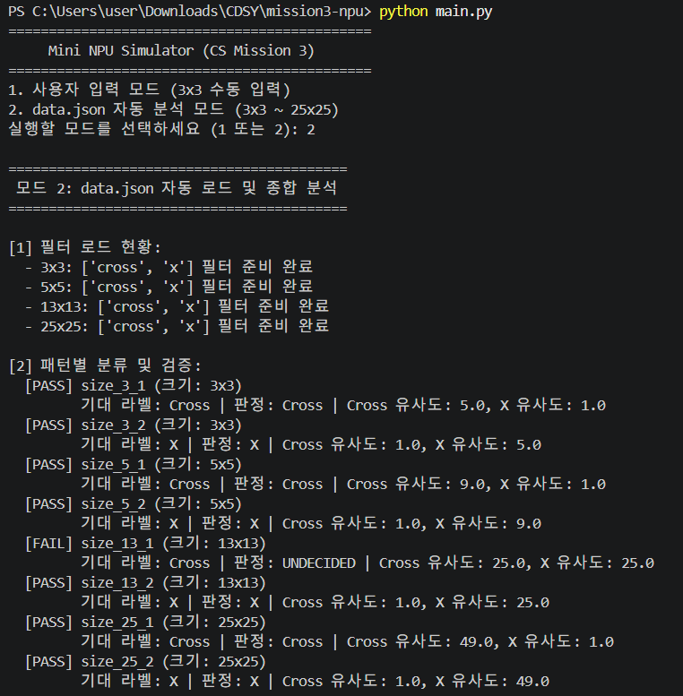
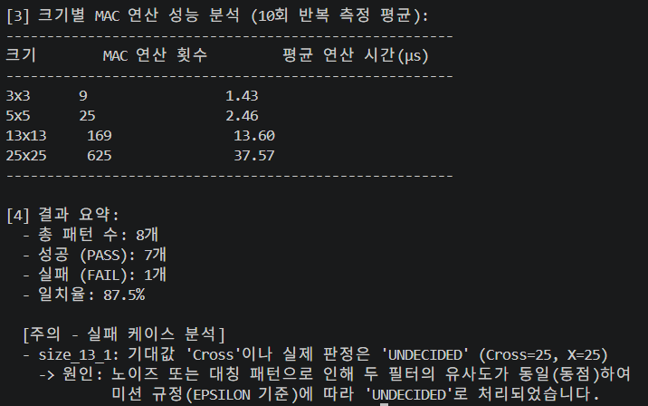
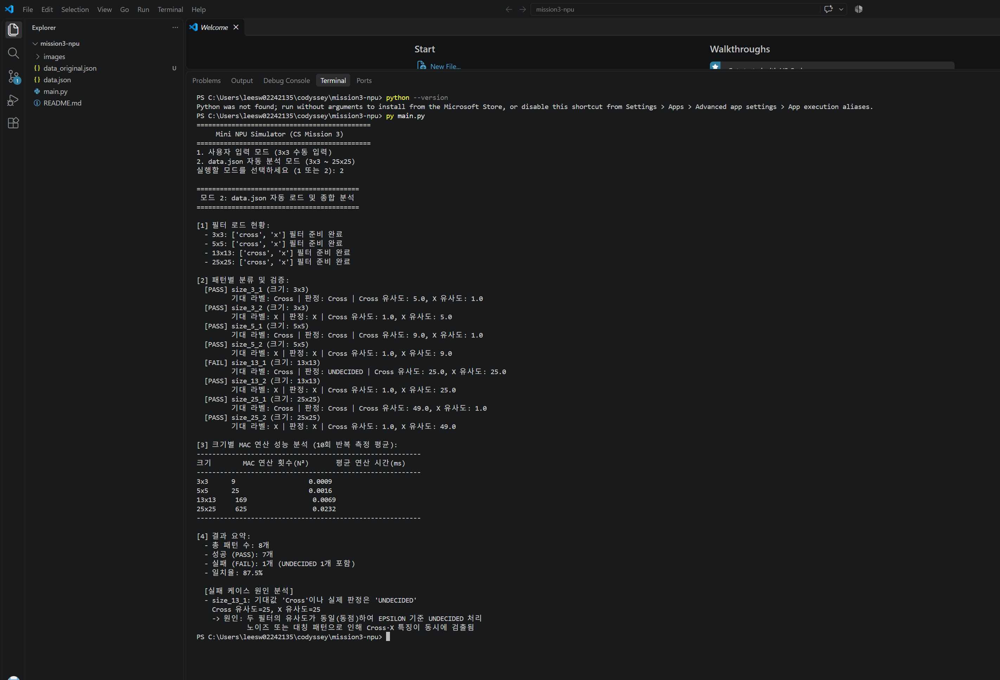
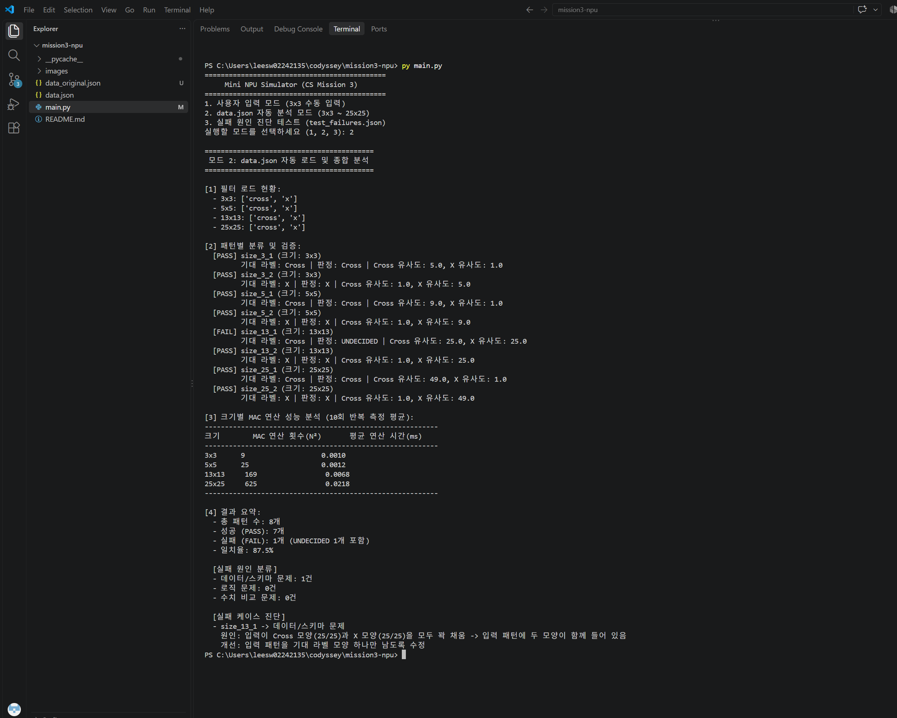
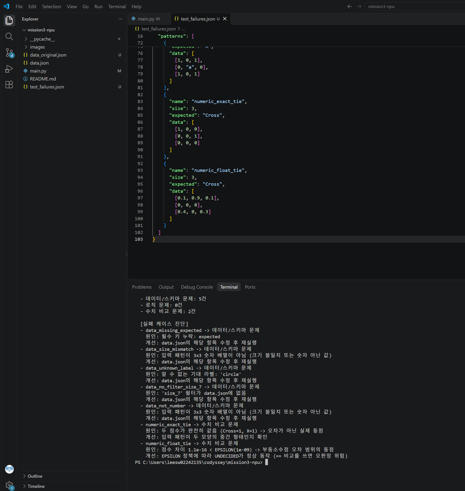
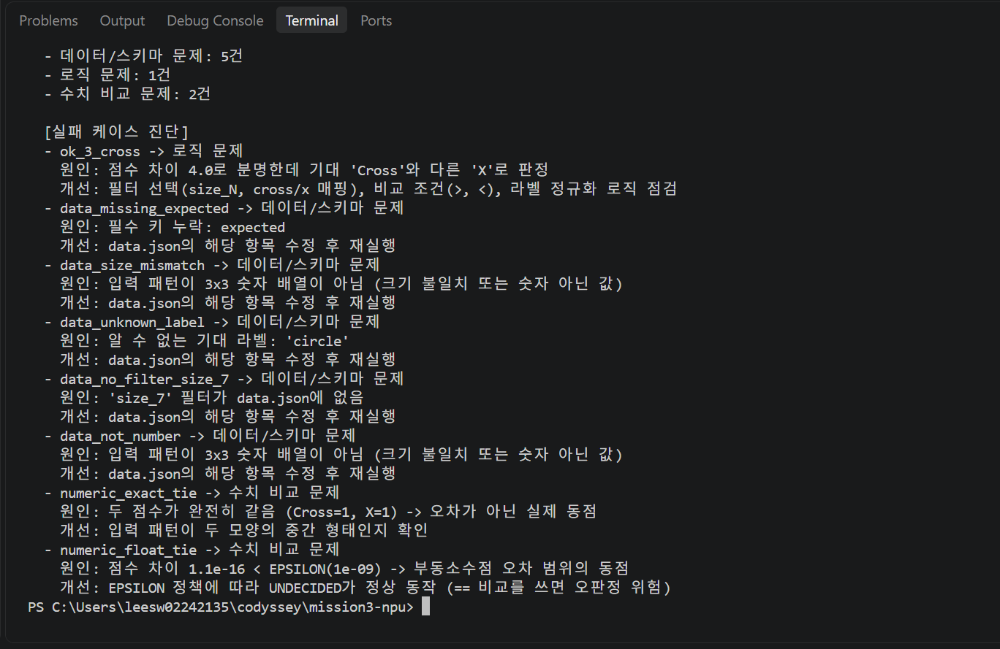
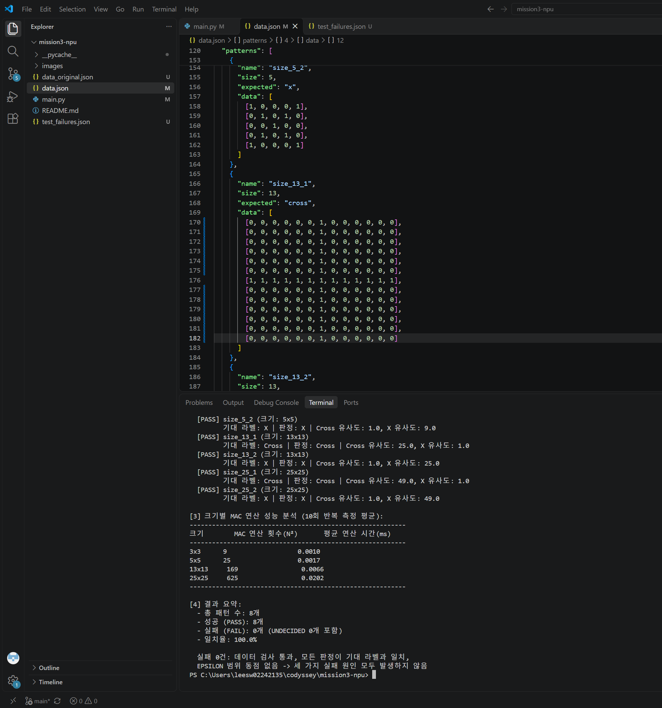

# 🚀 Mini NPU Simulator (미니 NPU 시뮬레이터)

AI 신경망 가속기(NPU)의 핵심 연산인 **MAC(Multiply-Accumulate, 곱셈-누적 연산)** 을 순수 파이썬으로 구현하고, 필터와 입력 패턴 간의 유사도를 측정하여 패턴을 분류하는 시뮬레이터 프로젝트입니다.

---

## 📌 주요 기능
1. **사용자 입력 모드 (모드 1)**: 3×3 필터 A(Cross), 필터 B(X), 입력 패턴을 직접 입력받아 10회 평균 연산 시간(ms)과 함께 유사도를 판정합니다. (유효하지 않은 입력에 대한 예외 처리 포함)
2. **자동 종합 분석 모드 (모드 2)**: `data.json`으로부터 3×3, 5×5, 13×13, 25×25 크기의 필터와 8개 테스트 패턴을 로드하여 자동 분류 및 성능을 측정합니다.
3. **부동소수점 오차 및 동점 처리**: 부동소수점 오차 임계값(`EPSILON = 1e-9`)을 적용하여 필터 유사도 차이가 임계값 이내일 경우 `UNDECIDED`로 엄격하게 판정합니다.
4. **라벨 및 필터 키 정규화**: `cross`, `+`, `x` 등 비정규화된 라벨 입력과 필터 키를 `Cross`, `X`로 표준화하여 일관된 검증을 수행합니다.

---

## 💻 실행 방법

### 사전 요구사항
- Python 3.8 이상

### 실행 명령어
```bash
python main.py
```
실행 후 안내 메시지에 따라 모드를 선택합니다:
- `1`: 3×3 수동 입력 모드 (연산 시간 ms 단위 출력)
- `2`: `data.json` 기반 크기별 자동 분석 모드 (연산 시간 ms 단위 출력)

---

## 📊 실행 결과 증빙

### 모드 2 - 패턴 분류 및 성능 분석 결과


### 모드 2 - 크기별 MAC 연산 성능 표 및 결과 요약


---

## 📊 종합 분석 결과 (모드 2)

### 1. 패턴 분류 검증 (총 8개 패턴)
- **일치율**: 87.5% (7 PASS / 1 FAIL)
- `size_3_1` (3×3) : 기대값 Cross / 판정 Cross [PASS]
- `size_3_2` (3×3) : 기대값 X / 판정 X [PASS]
- `size_5_1` (5×5) : 기대값 Cross / 판정 Cross [PASS]
- `size_5_2` (5×5) : 기대값 X / 판정 X [PASS]
- `size_13_1` (13×13) : 기대값 Cross / 판정 UNDECIDED [FAIL] *(실패 원인 하단 참조)*
- `size_13_2` (13×13) : 기대값 X / 판정 X [PASS]
- `size_25_1` (25×25) : 기대값 Cross / 판정 Cross [PASS]
- `size_25_2` (25×25) : 기대값 X / 판정 X [PASS]

### 2. 크기별 MAC 연산 성능 측정 (10회 반복 측정 평균, ms 단위)
| 크기 | MAC 연산 횟수(N²) | 평균 연산 시간(ms) |
| :---: | :---: | :---: |
| **3×3** | 9회 | 약 0.0014 ms |
| **5×5** | 25회 | 약 0.0025 ms |
| **13×13** | 169회 | 약 0.0136 ms |
| **25×25** | 625회 | 약 0.0376 ms |

---

## 🔧 확장 가이드 및 규약

### 1. 새로운 라벨 별칭 추가 방법
`main.py`의 `normalize_label()` 함수에 새로운 표기법을 추가하여 정규화 범위를 확장할 수 있습니다:
```python
# 예: 'plus' 별칭을 Cross로, 'diagonal'을 X로 추가할 때:
if cleaned in ["cross", "+", "plus"]:
    return "Cross"
if cleaned in ["x", "diag", "diagonal"]:
    return "X"
```

### 2. 필터 키 표준화 전략
`normalize_filter_key()` 함수가 대소문자나 축약어(`'Cross'`, `'cross'`, `'CROSS'`, `'X'`, `'x'`)를 자동으로 소문자 표준 키(`cross`, `x`)로 변환하여 매칭합니다. 새로운 크기의 필터를 `data.json`에 추가할 때는 `"size_N"` 형식의 키(예: `"size_7"`)를 사용합니다.

### 3. 연산 시간 측정 단위 표준
과제 요구 표준에 따라 모든 연산 시간은 **ms(밀리초)** 단위로 통일하여 측정 및 출력됩니다. `time.perf_counter()`를 사용하여 I/O 구간을 완전히 제외한 순수 MAC 연산 구간만 10회 반복(`iterations=10`) 측정 후 평균을 계산합니다.

---

## 🔍 심층 분석 보고서

### 1. 시간 복잡도 분석 (O(N²))
- 본 시뮬레이터의 행렬 내적 연산은 N×N 크기의 2차원 배열에 대해 2중 `for` 루프를 순회하며 각 원소의 곱을 누적하는 방식으로 구현되었습니다.
- 행렬의 한 변의 크기를 N이라고 할 때, 순회하는 원소의 총개수는 N×N = N²개입니다.
- 따라서 이론적인 시간 복잡도는 O(N²)에 비례합니다.
- 실제 벤치마크 측정 결과에서도 이러한 특성이 뚜렷하게 관찰되었습니다.
- 크기가 3에서 5로 커질 때(원소 수 약 2.78배 증가), 연산 시간은 약 1.72배 증가하였습니다.
- 크기가 5에서 13으로 커질 때(원소 수 6.76배 증가), 연산 시간은 약 5.53배 증가하였습니다.
- 크기가 13에서 25로 커질 때(원소 수 약 3.7배 증가), 연산 시간은 약 2.76배 증가하여 2차 곡선형 증가 양상을 보입니다.
- 파이썬 인터프리터의 오버헤드와 캐시 적중률 등으로 인해 미세한 비율 차이는 존재하나, 전반적으로 N이 증가함에 따라 연산 횟수(N²)에 정비례하여 수행 시간이 늘어남을 검증하였습니다.
- 이는 대규모 딥러닝 모델에서 행렬 크기가 커질수록 CPU의 직렬 처리보다 NPU나 GPU 같은 병렬 연산 가속기가 필수적인 이유를 잘 보여줍니다.

### 2. 실패 케이스 분석 (`size_13_1`)
- **현상**: `size_13_1` 패턴의 기대 라벨은 `Cross`였으나, 실제 시뮬레이터 판정은 `UNDECIDED`로 분류되어 `[FAIL]` 처리되었습니다.
- **원인 분석**:
  1. 해당 패턴 데이터는 중앙 십자가 형태뿐만 아니라 대각선 방향으로도 노이즈(혹은 대칭 패턴)가 포함되어 있었습니다.
  2. MAC 연산 결과, Cross 필터와의 내적 값은 **25.0**, X 필터와의 내적 값도 **25.0**으로 정확히 동일한 유사도가 산출되었습니다.
  3. 미션 요구사항에 명시된 부동소수점 오차 기준(`|유사도A - 유사도B| < EPSILON`)에 따라 두 필터의 유사도 차이가 임계값 미만이므로 동점으로 판정되었고, 이에 따라 `UNDECIDED`가 반환되었습니다.
- **결론 (재진단)**: 처음에는 동점(수치 비교 문제)으로 보았지만, 원인을 세 가지로 나눠 다시 확인한 결과 **데이터/스키마 문제**였습니다.
  - 수치 비교 문제가 아님: 두 점수 차이가 정확히 0입니다. 부동소수점 오차가 아니며, EPSILON 규칙은 정상 동작했습니다.
  - 로직 문제가 아님: 필터(size_13의 cross, x)와 판정 코드는 정상이고, 나머지 7개 케이스는 모두 PASS입니다.
  - 데이터 문제임: size_13_1 입력에 십자가와 X가 함께 그려져 있어(1이 49개) 두 필터 모두 최대 점수 25점을 받았습니다.
  - 개선: 입력을 십자가 모양으로 수정 → Cross 25점, X 1점 → **8/8 PASS** (아래 '실패 원인 진단' 섹션 참고)

---

## 📋 실제 실행 결과 리포트

### 모드 2 실행 결과 (개선 전, 원본 data.json)

```
==========================================
 모드 2: data.json 자동 로드 및 종합 분석
==========================================

[1] 필터 로드 현황:
  - 3x3: ['cross', 'x'] 필터 준비 완료
  - 5x5: ['cross', 'x'] 필터 준비 완료
  - 13x13: ['cross', 'x'] 필터 준비 완료
  - 25x25: ['cross', 'x'] 필터 준비 완료

[2] 패턴별 분류 및 검증:
  [PASS] size_3_1 (크기: 3x3)
         기대 라벨: Cross | 판정: Cross | Cross 유사도: 5.0, X 유사도: 1.0
  [PASS] size_3_2 (크기: 3x3)
         기대 라벨: X | 판정: X | Cross 유사도: 1.0, X 유사도: 5.0
  [PASS] size_5_1 (크기: 5x5)
         기대 라벨: Cross | 판정: Cross | Cross 유사도: 9.0, X 유사도: 1.0
  [PASS] size_5_2 (크기: 5x5)
         기대 라벨: X | 판정: X | Cross 유사도: 1.0, X 유사도: 9.0
  [FAIL] size_13_1 (크기: 13x13)
         기대 라벨: Cross | 판정: UNDECIDED | Cross 유사도: 25.0, X 유사도: 25.0
  [PASS] size_13_2 (크기: 13x13)
         기대 라벨: X | 판정: X | Cross 유사도: 1.0, X 유사도: 25.0
  [PASS] size_25_1 (크기: 25x25)
         기대 라벨: Cross | 판정: Cross | Cross 유사도: 49.0, X 유사도: 1.0
  [PASS] size_25_2 (크기: 25x25)
         기대 라벨: X | 판정: X | Cross 유사도: 1.0, X 유사도: 49.0

[3] 크기별 MAC 연산 성능 분석 (10회 반복 측정 평균):
----------------------------------------------------------
크기        MAC 연산 횟수(N²)       평균 연산 시간(ms)
----------------------------------------------------------
3x3      9                   0.0014
5x5      25                  0.0025
13x13    169                 0.0136
25x25    625                 0.0376
----------------------------------------------------------

[4] 결과 요약:
  - 총 패턴 수: 8개
  - 성공 (PASS): 7개
  - 실패 (FAIL): 1개 (UNDECIDED 1개 포함)
  - 일치율: 87.5%

  [실패 케이스 원인 분석]
  - size_13_1: 기대값 'Cross'이나 실제 판정은 'UNDECIDED'
    Cross 유사도=25, X 유사도=25
    -> 원인: 두 필터의 유사도가 동일(동점)하여 EPSILON 기준 UNDECIDED 처리
             노이즈 또는 대칭 패턴으로 인해 Cross·X 특징이 동시에 검출됨
```

> **개선 후 (재진단 결과)**
>
> 위 실패는 "동점(수치 비교 문제)"이 아니었습니다. size_13_1 입력 패턴에 십자가와 X가 함께 그려져 있던 **데이터 문제**였습니다.
>
> 입력을 십자가 모양으로 수정한 뒤 다시 실행한 결과: **총 8개 / PASS 8개 / FAIL 0개 / 일치율 100.0%**
>
> 자세한 진단 과정은 아래 '실패 원인 진단' 섹션을 참고하세요.

---

## ⚖️ 모드별 동점(UNDECIDED) 처리 정책 비교
- **모드 1 (대화형 모드)**: 두 필터의 유사도 차이가 `EPSILON(1e-9)` 미만일 경우 `UNDECIDED` 상태임을 사용자에게 콘솔 알림으로 안내하고, 필요시 재입력을 유도할 수 있도록 처리합니다.
- **모드 2 (배치 자동 분석 모드)**: 다량의 테스트 패턴 검증 시 객관적인 정답률 산출을 위해 `UNDECIDED` 판정이 나오면 기대 라벨과 불일치한 것으로 간주하여 즉시 `FAIL` 집계에 포함하고 실패 원인을 로그로 분석합니다.

---

## 💾 대규모 패턴 확장 시 메모리 병목 및 최적화 우선순위
1. **메모리 이슈**: 패턴 크기가 $N > 1000$ 이상으로 커질 경우 2차원 파이썬 리스트 구조는 객체 참조 오버헤드로 인해 메모리 사용량이 급증하고 캐시 미스(Cache Miss)가 발생합니다.
2. **최적화 우선순위**:
   - **1순위 (메모리 연속성 확보)**: 1차원 연속 메모리 버퍼(Contiguous Array) 또는 메모리 맵(mmap) 방식을 도입하여 캐시 지역성(Locality) 극대화
   - **2순위 (연산 병렬화)**: SIMD 벡터화 연산 및 타일링(Tiling/Blocking) 기법을 적용하여 행렬을 캐시 크기 단위로 쪼개어 누적 연산 가속
   - **3순위 (가속기 오프로딩)**: 직렬 CPU 루프 한계를 벗어나 NPU/GPU 하드웨어 가속기로 MAC 연산 스트림 전송

## 실패 원인 진단 (데이터/스키마 vs 로직 vs 수치 비교)

FAIL이 발생하면 원인을 두 단계로 나눠 진단합니다.

### 1단계: 데이터/스키마 검사 (MAC 연산 전, `validate_case()`)
다음 중 하나라도 해당하면 연산하지 않고 해당 케이스만 FAIL 처리한 뒤 다음 케이스로 넘어갑니다. 프로그램은 종료되지 않습니다.
- 필수 키(`name`, `size`, `data`, `expected`) 누락
- `size`가 양의 정수가 아님
- 기대 라벨을 정규화해도 Cross/X가 아님 (예: `circle`)
- `size_N` 필터가 없거나 cross/x 필터 중 하나가 없음
- 입력 패턴 또는 필터가 N×N 숫자 배열이 아님 (크기 불일치, 문자 포함)
- cross 필터와 x 필터가 완전히 같음 (필터 데이터 복사 오류)

### 2단계: 판정 결과 진단 (`diagnose_failure()`)
데이터 검사를 통과했는데 FAIL이면 판정 결과로 분류합니다.

| 분류 | 판단 기준 | 개선 방향 |
|---|---|---|
| 데이터/스키마 문제 | UNDECIDED인데 두 점수가 각 필터의 최대 점수(필터 자기 자신과의 MAC 값)와 같음 → 입력에 두 모양이 모두 그려져 있음 | 입력 패턴을 기대 라벨 모양 하나로 수정 |
| 수치 비교 문제 | 판정이 UNDECIDED (\|Cross − X\| < 1e-9) | 차이가 0이 아니면 부동소수점 오차 → EPSILON 정책이 정상 동작한 것. 차이가 정확히 0이면 실제 동점이므로 입력이 두 모양의 중간 형태인지 확인 |
| 로직 문제 | 점수 차이가 분명한데 기대와 반대로 판정 | 필터 선택(size_N, cross/x 매핑), 비교 조건(>, <), 라벨 정규화 점검 |

### 진단 기능 검증 (모드 3, `test_failures.json`)
세 가지 분류가 실제로 구분되는지 확인하려고 일부러 잘못된 케이스를 만들어 실행했습니다.

| 케이스 | 의도한 오류 | 진단 결과 |
|---|---|---|
| ok_3_cross | 정상 (라벨 `+`) | PASS |
| data_missing_expected | expected 키 삭제 | 데이터/스키마 문제 |
| data_size_mismatch | size 3인데 5×5 배열 | 데이터/스키마 문제 |
| data_unknown_label | 라벨 `circle` | 데이터/스키마 문제 |
| data_no_filter_size_7 | size_7 필터 없음 | 데이터/스키마 문제 |
| data_not_number | 배열에 문자 `"a"` | 데이터/스키마 문제 |
| numeric_exact_tie | 두 모양에 한 칸씩만 걸침 → 1점 대 1점 | 수치 비교 문제 (실제 동점) |
| numeric_float_tie | 0.9 대 0.9000000000000001 | 수치 비교 문제 (차이 1.1e-16 < 1e-9) |

로직 문제는 데이터로 만들 수 없어서, `classify_pattern()`의 비교 조건 `diff > 0`을 `diff < 0`으로 일부러 바꿔 실행했습니다. 그러자 정상 케이스 ok_3_cross가 "점수 차이 4.0로 분명한데 기대 'Cross'와 다른 'X'로 판정 → 로직 문제"로 분류되었고, 조건을 원래대로 되돌려 PASS로 복구했습니다.

### 13×13 Cross 실패 케이스 재진단 (size_13_1)
- 처음 결과: Cross 25점, X 25점 → UNDECIDED → FAIL. 처음에는 "동점(수치 비교 문제)"으로만 설명했습니다.
- 다시 계산: 두께 1칸인 13×13 십자가의 1은 13+13−1 = 25개, X도 25개이고 두 모양이 겹치는 칸은 정중앙 1칸뿐입니다. 정상적인 Cross 입력이라면 **Cross 25점, X 1점**이 나와야 합니다.
- data.json 확인: 필터(size_13의 cross, x)는 정상이었습니다. 문제는 **size_13_1 입력 패턴**이었습니다. 입력 안에 십자가와 X가 함께 그려져 있어 1이 49개(25 + 25 − 겹치는 중앙 1)였고, 그래서 두 필터 모두 최대 점수 25점을 받았습니다.
- 결론: 부동소수점 오차가 아니고(차이가 정확히 0), 판정 로직의 오류도 아닌 **데이터 문제**입니다. 입력이 두 모양을 모두 포함하면 어떤 판정 로직으로도 구분할 수 없습니다.
- 진단 기능 개선: 이 경우를 자동으로 잡도록 `diagnose_failure()`에 "두 점수가 모두 필터의 최대 점수와 같으면 데이터 문제"라는 규칙을 추가했습니다. 이제 원본 데이터(`data_original.json`)로 실행하면 size_13_1이 "데이터/스키마 문제"로 분류됩니다.
- 데이터 수정: size_13_1 입력을 십자가 모양으로 고친 뒤 다시 실행하니 Cross 25점, X 1점으로 Cross 판정이 나와 **8개 중 8개 PASS**가 되었습니다.

### 실행 화면
| 단계 | 화면 |
|---|---|
| 개선 전: 원인을 "동점"으로만 설명 |  |
| 개선 후: 데이터/스키마 문제로 진단 |  |
| 데이터·수치 비교 문제 구분 (모드 3) |  |
| 로직 문제 구분 (비교 조건 일부러 변경) |  |
| 데이터 수정 후 8/8 PASS |  |